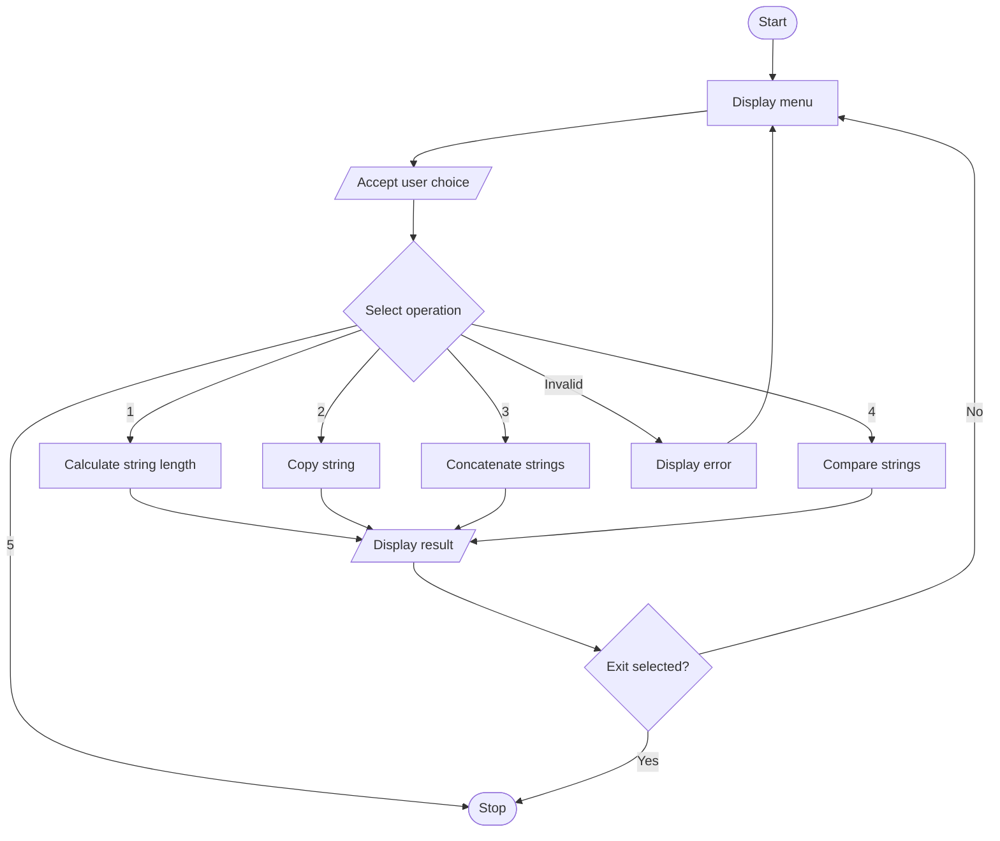

# Menu-Driven-Program-in-C-using-Strings


Menu-Driven String Operations in C

## 1. Problem Statement

Write a menu-driven program in C to perform various string operations using built-in string functions.

## 2. Objectives

- To learn different string operations in C.
- To understand functions in the C programming language.
- To perform string operations using built-in library functions.
- To understand menu-driven programming using loops and `switch` statements.

## 3. Theory

### What is a Function?

A function is a block of code designed to perform a specific task. Functions make programs easier to understand, reuse, test, and maintain.

Functions in C are broadly classified into:

1. **Library functions:** Predefined functions provided by the C standard library, such as `printf()`, `strlen()`, and `strcpy()`.
2. **User-defined functions:** Functions written by the programmer to perform specific tasks.

### What is a String?

A string in C is a sequence of characters terminated by the null character `\0`. Strings are stored in character arrays.

**Syntax:**

```c
char string_name[size];
```

**Example:**

```c
char name[20] = "Hello";
```

### Built-in String Functions

The `string.h` header file provides functions for manipulating strings.

| Function | Description |
|---|---|
| `strlen()` | Calculates the length of a string. |
| `strcpy()` | Copies one string into another. |
| `strcat()` | Appends one string to another. |
| `strcmp()` | Compares two strings. |
| `strchr()` | Searches for a character in a string. |
| `strstr()` | Searches for a substring within a string. |

**Header file:**

```c
#include <string.h>
```

### What is a Menu-Driven Program?

A menu-driven program displays a list of available operations and allows the user to select an option. A `switch` statement can execute the selected operation, while a loop can display the menu repeatedly until the user chooses to exit.

## 4. Algorithm

1. Start the program.
2. Declare the required character arrays and variables.
3. Display the menu of string operations.
4. Accept the user's choice.
5. Use a `switch` statement to select the operation.
6. Perform the selected string operation.
7. Display the result.
8. Repeat the menu until the user chooses Exit.
9. Stop the program.

## 5. C Program

```c
#include <stdio.h>
#include <string.h>

int main() {
    char str1[200], str2[100];
    int choice, result;

    do {
        printf("\n--- STRING OPERATIONS MENU ---\n");
        printf("1. Find Length of String\n");
        printf("2. Copy String\n");
        printf("3. Concatenate Strings\n");
        printf("4. Compare Strings\n");
        printf("5. Exit\n");
        printf("Enter your choice: ");
        scanf("%d", &choice);
        getchar();

        switch (choice) {
            case 1:
                printf("Enter a string: ");
                fgets(str1, sizeof(str1), stdin);
                str1[strcspn(str1, "\n")] = '\0';

                printf("Length of string = %zu\n",
                       strlen(str1));
                break;

            case 2:
                printf("Enter the source string: ");
                fgets(str2, sizeof(str2), stdin);
                str2[strcspn(str2, "\n")] = '\0';

                strcpy(str1, str2);
                printf("Copied string = %s\n", str1);
                break;

            case 3:
                printf("Enter the first string: ");
                fgets(str1, sizeof(str1), stdin);
                str1[strcspn(str1, "\n")] = '\0';

                printf("Enter the second string: ");
                fgets(str2, sizeof(str2), stdin);
                str2[strcspn(str2, "\n")] = '\0';

                if (strlen(str1) + strlen(str2)
                    < sizeof(str1)) {
                    strcat(str1, str2);
                    printf("Concatenated string = %s\n",
                           str1);
                } else {
                    printf("Combined string is too long.\n");
                }
                break;

            case 4:
                printf("Enter the first string: ");
                fgets(str1, sizeof(str1), stdin);
                str1[strcspn(str1, "\n")] = '\0';

                printf("Enter the second string: ");
                fgets(str2, sizeof(str2), stdin);
                str2[strcspn(str2, "\n")] = '\0';

                result = strcmp(str1, str2);

                if (result == 0)
                    printf("Strings are equal.\n");
                else
                    printf("Strings are different.\n");
                break;

            case 5:
                printf("Exiting program.\n");
                break;

            default:
                printf("Invalid choice. Try again.\n");
        }

    } while (choice != 5);

    return 0;
}
```

## 6. Sample Input and Output

### Operation 1: Find String Length

**Input:**

```text
Enter your choice: 1
Enter a string: Programming
```

**Output:**

```text
Length of string = 11
```

### Operation 2: Copy a String

**Input:**

```text
Enter your choice: 2
Enter the source string: Hello World
```

**Output:**

```text
Copied string = Hello World
```

### Operation 3: Concatenate Strings

**Input:**

```text
Enter your choice: 3
Enter the first string: Hello
Enter the second string: World
```

**Output:**

```text
Concatenated string = HelloWorld
```

### Operation 4: Compare Strings

**Input:**

```text
Enter your choice: 4
Enter the first string: Hello
Enter the second string: Hello
```

**Output:**

```text
Strings are equal.
```

### Operation 5: Exit

**Input:**

```text
Enter your choice: 5
```

**Output:**

```text
Exiting program.
```

## 7. Flowchart



## 8. FAQs

### Q1. When should I declare a function?

A function should be declared before it is called if its definition has not already appeared earlier in the source code. A function declaration specifies its name, return type, and parameter types.

### Q2. What are the different types of functions in C?

The two broad categories are library functions and user-defined functions. Functions can also be classified according to whether they accept arguments and return values.

### Q3. What are the different built-in string functions?

Common string functions include `strlen()`, `strcpy()`, `strcat()`, `strcmp()`, `strchr()`, and `strstr()`. They are declared in `string.h` and are used to calculate string length, copy strings, concatenate strings, compare strings, and search for characters or substrings.

## 9. Conclusion

Thus, a menu-driven program was implemented successfully in C to perform various string operations using built-in string functions. This experiment helped develop an understanding of strings, library functions, loops, and conditional statements.
